# DAWOOD UNIVERSITY OF ENGINEERING & TECHNOLOGY
### DEPARTMENT OF DATA SCIENCE
## DATABASE SYSTEMS — ASSIGNMENT 01

---

### Student Submission Details

  

| Attribute | Details |
| :--- | :--- |
| **Name** | Bheesham Kumar Sajnani |
| **Roll Number** | 25F-DS-020 |
| **Section** | 25F-DS |
| **Lab / Assignment Title** | Database Systems — Assignment 01 |
| **Subject** | Database Systems |
| **Instructor** | Engr. Seema Bughio |
| **Batch** | Batch 25 |
| **Sessional Marks** | 5 |
| **Deadline** | 10-OCT-2026 |

---

## Task 01: Database Role in Information Systems

**Requirements / Details:**  
Explain how a database supports a University Information System. Identify at least four types of information that can be stored in the database and explain how different users can use this information.

### Solution:

A University Information System (UIS) relies on a centralized Relational Database Management System (DBMS) as its core foundation. Rather than managing separate files or isolated spreadsheets across departments—which leads to mismatched records, errors, and duplicate data—the database provides:

1. **Centralized Single Source of Truth:** Unifies student records, fee status, and examination grades in one coordinated relational model.
2. **Referential Integrity & Constraints:** Prevents anomalies using Primary Keys, Foreign Keys, and Check constraints (e.g., ensuring course grades cannot be awarded to non-existent student IDs).
3. **Multi-User Concurrency (ACID Properties):** Allows hundreds of students and faculty members to register, enter attendance, or check grades at the same time without data loss or race conditions.
4. **Data Security & Privacy:** Granular database permissions ensure sensitive data like exam marks, question papers, and staff salaries are shielded from unauthorized users.

---

### University Information System Architecture
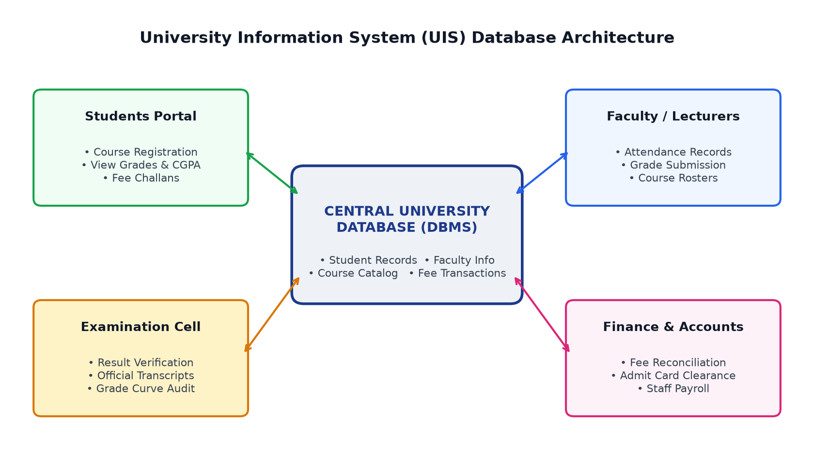

---

### Four Types of Information Stored in the University Database

| # | Information Type | Attributes Stored |
|---|---|---|
| **1** | **Student Academic Records** | Student ID, Name, Department, Enrollment Year, Courses Enrolled, Attendance percentage, Semester GPAs, Cumulative CGPA. |
| **2** | **Faculty & Staff Records** | Faculty ID, Name, Academic Rank, Department, Assigned Course Modules, Timetable Allocations, Contact Info, Payroll. |
| **3** | **Course Catalog** | Course Code (e.g., `DS-211`), Title, Credit Hours (Theory + Lab), Prerequisites, Syllabus, Allocated Classroom/Lab. |
| **4** | **Financial & Fee Transactions** | Challan / Voucher Number, Student ID, Due Date, Tuition Fee Amount, Payment Status (Paid/Pending), Bank Transaction ID. |

---

### How Different Users Utilize This Information
* **Students:** Log into the portal to check timetables, register for semester courses, monitor course attendance, view published exam marks and CGPA, and download fee challans.
* **Faculty / Lecturers:** Access class rosters, take lecture and lab attendance, enter marks for quizzes, assignments, midterms, and finals, and calculate internal assessments.
* **Examination Cell:** Verify submitted marks, audit class grade curves, check prerequisite clearance, enforce academic probation rules, and issue certified transcripts.
* **Finance & Accounts:** Reconcile fee payments with bank deposits, clear students for examination admit cards, and process employee monthly payroll.

---

## Task 02: Basic Database Security

**Requirements / Details:**  
A university database contains students' personal information and examination results. Identify three basic security measures that should be implemented to protect this data. Explain the purpose of each measure.

### Solution:

### 1. Authentication and Role-Based Access Control (RBAC)
* **Mechanism:** Users authenticate through secure credentials using salted password hashing (e.g., bcrypt/Argon2) and Multi-Factor Authentication (MFA) for administrative roles. Access permissions follow the Principle of Least Privilege (PoLP):
  * **Students** only have `SELECT` access strictly to their own individual marks via secure views.
  * **Faculty** have `SELECT`, `INSERT`, and `UPDATE` permissions only for marks in their assigned courses.
  * **Examination Cell** has administrative permissions to finalize and lock grades.
* **Purpose:** Prevents unauthorized logins, identity impersonation, and unauthorized grade modifications by students.

### 2. Data Encryption (In-Transit and At-Rest)
* **Mechanism:**
  * **In-Transit:** Enforce Transport Layer Security (TLS 1.3 / HTTPS) on all connections between browsers/clients and the database, preventing packet sniffing and man-in-the-middle (MITM) attacks.
  * **At-Rest:** Use Transparent Data Encryption (TDE) with AES-256 on physical storage volumes, data files, and database backup archives.
* **Purpose:** Guarantees data confidentiality. Even if network packets are intercepted or a backup storage disk is stolen, the data cannot be read without cryptographic keys.

### 3. Database Auditing, Activity Logging & Check Constraints
* **Mechanism:** Automated database audit logs record every sensitive grade update (User ID, Old Marks, New Marks, Timestamp, and IP Address). In addition, domain `CHECK` constraints (e.g., `0 <= Marks <= 100`) validate all inputs before committing.
* **Purpose:** Guarantees accountability, non-repudiation, and traceability. Any unauthorized tampering attempt is recorded with forensic detail and can be rolled back to verified states.

---

### Multi-Layer Database Security Architecture
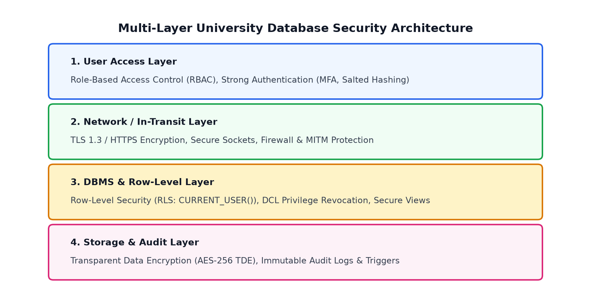

---

## Task 03: DBMS Operations (SQL Queries)

**Requirements / Details:**  
Given a Student table containing `Student_ID`, `Name`, `Department`, and `CGPA`, write SQL queries to perform the following operations:
1. Display students with CGPA greater than 3.0.
2. Change the department of a particular student.
3. Remove a student from the table.
4. Add a new student.

---

### Table Schema & Initial Records Setup

#### QUERY:
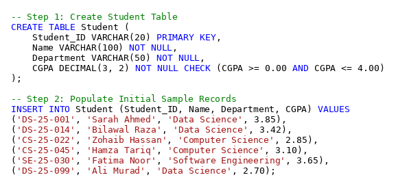

#### OUTPUT:
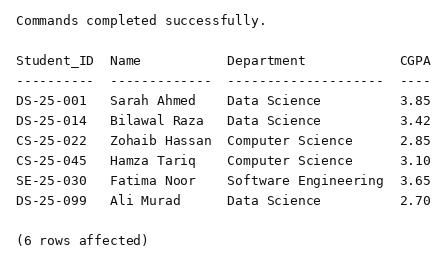

---

### Operation 01: Display students with CGPA greater than 3.0
* **Purpose:** Retrieve student records where the `CGPA` column value strictly exceeds 3.0.

#### QUERY:
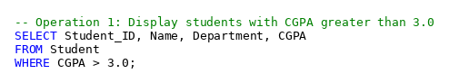

#### OUTPUT:
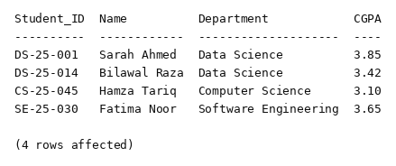

---

### Operation 02: Change the department of a particular student
* **Purpose:** Update the `Department` value to `'Data Science'` for a specific student (`Student_ID = 'CS-25-045'`) identified by primary key.

#### QUERY:
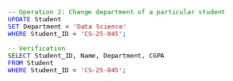

#### OUTPUT:
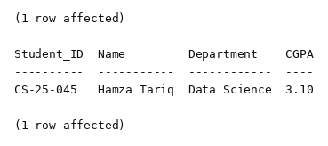

---

### Operation 03: Remove a student from the table
* **Purpose:** Delete a student record (`Student_ID = 'DS-25-099'`) using their unique identifier without affecting other records.

#### QUERY:
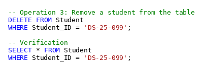

#### OUTPUT:
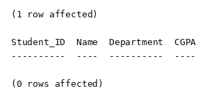

---

### Operation 04: Add a new student
* **Purpose:** Insert a new student record (`'DS-25-102'`, `'Ayesha Khan'`, `'Data Science'`, `3.78`) into the `Student` table.

#### QUERY:
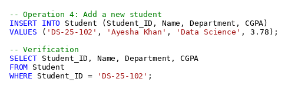

#### OUTPUT:
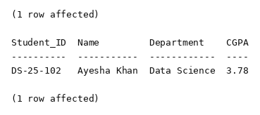

---

## Task 04: Security Scenario

**Requirements / Details:**  
A student is able to access and modify another student's examination marks through the university database system.
* **a)** What security problem exists?
* **b)** What database security mechanism could help prevent this problem?

---

### Part (a): What Security Problem Exists?
1. **Broken Access Control & Insecure Direct Object Reference (IDOR):** The application and database tier fail to verify user ownership. A student is able to supply another student's identifier and execute modifications against it.
2. **Violation of the Principle of Least Privilege:** Normal student accounts possess unpermitted `UPDATE` and `INSERT` permissions on examination marks tables, which should belong exclusively to instructors and examination controllers.
3. **Breach of Confidentiality & Integrity:**
   * *Confidentiality:* Peer examination marks are exposed.
   * *Integrity:* Unauthorized users can corrupt and falsify university grades, compromising institutional academic credibility.

---

### Part (b): Database Security Mechanism to Prevent This
1. **Privilege Revocation (DCL):** Revoke all `UPDATE`, `INSERT`, and `DELETE` permissions on `Examination_Marks` from the `Student_Role`.
2. **Row-Level Security (RLS):** Enforce Row-Level Security policies at the DBMS level so students can strictly view rows matching `Student_ID = CURRENT_USER()`.
3. **Secure Views & Stored Procedures:** Restrict student queries to a secure view (`View_Student_Own_Marks`). All grade alterations by faculty must pass through validated stored procedures.
4. **Audit Triggers:** Set up an `AFTER UPDATE` database trigger that automatically logs any changes to an immutable audit table.

#### QUERY:
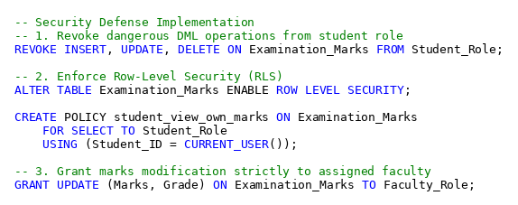

#### OUTPUT:
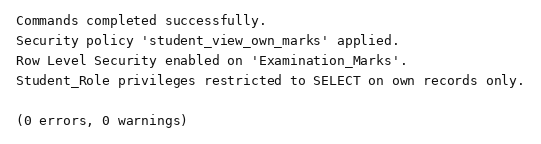
